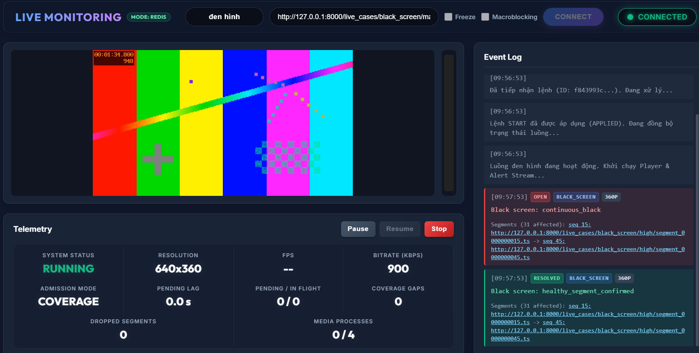
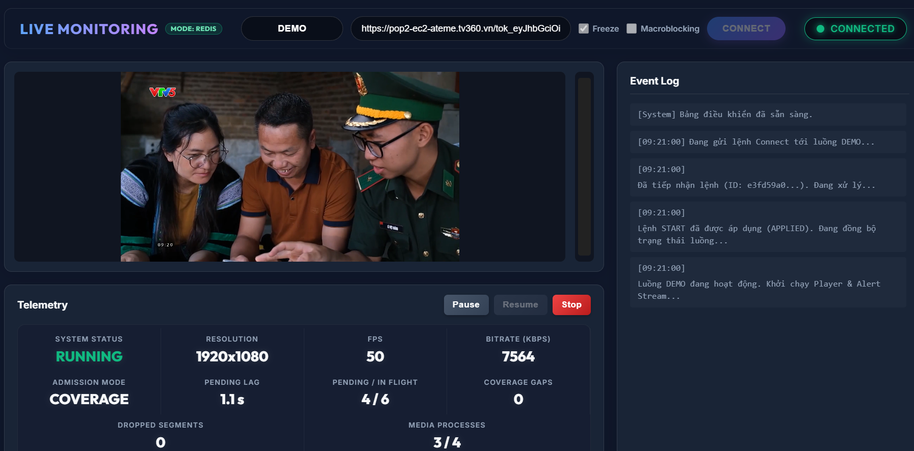
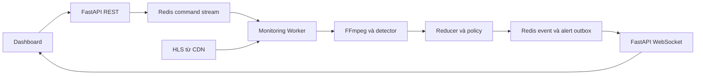

# Live HLS Media Monitor

Hệ thống giám sát lỗi nội dung truyền hình HLS, phát hiện **đen hình, đứng hình và mất tiếng**, hiển thị cảnh báo trên dashboard kèm link segment bị ảnh hưởng.

Đây là **bản demo báo cáo ngày 27/10/2026**, dùng cùng source đã chọn lọc để gửi mentor, bao gồm bản sửa trạng thái freeze sau phục hồi. Phạm vi kiểm chứng là một stream và variant chất lượng cao nhất. Các thử nghiệm macroblocking offline, dataset và notebook không thuộc phiên bản này.

## Hình ảnh hoạt động

### Cảnh báo black-screen



Nhật ký hiển thị sự kiện `BLACK_SCREEN` với trạng thái `OPEN` và `RESOLVED`, variant 360p cùng link segment đầu/cuối. Ảnh chụp khi video đã phục hồi, vì vậy player đang hiển thị hình bình thường trong khi nhật ký vẫn lưu sự cố trước đó.

### Theo dõi một luồng live



Phiên giám sát trong ảnh đang ở trạng thái `RUNNING`, hiển thị thông tin video và tải xử lý. Các số liệu là ảnh chụp tại một thời điểm, không đại diện cho năng lực trên mọi kênh hoặc cấu hình máy.

## Chức năng chính

| Chức năng | Cách xử lý |
|---|---|
| Black-screen | `blackdetect`, nối event liên tục và đếm các event ngắn đủ điều kiện |
| Video freeze | `freezedetect`, loại phần giao với black, so ảnh biên khi nối qua segment |
| Audio-loss | `silencedetect`, phân biệt im lặng và thiếu audio track |
| Điều khiển stream | START, PAUSE, RESUME, STOP qua REST API |
| Cảnh báo | Redis Streams và WebSocket, có trạng thái và phạm vi segment |
| Quan sát vận hành | Trạng thái worker, queue lag, coverage gap và dropped segments |

Module macroblocking live dạng lưới được giữ vì đã tích hợp trong baseline và có fixture kiểm thử. Khi demo ba bệnh chính, bỏ chọn **Macroblocking**. Khả năng nhận biết macroblocking trên video quay màn hình hoặc tái mã hóa còn giới hạn.

## Luồng xử lý



Worker chọn variant video chất lượng cao nhất, theo dõi playlist và xử lý segment mới. Các phép kiểm tra video dùng chung lần giải mã của cùng segment. Reducer nối bằng chứng thành event; policy quyết định khi nào phát cảnh báo. Redis chuyển lệnh và lưu kết quả, còn worker lấy media trực tiếp từ nguồn HLS.

## Quy tắc mặc định

| Bệnh | Điều kiện mở cảnh báo | Điều kiện phục hồi |
|---|---|---|
| Black-screen liên tục | Event đen hình từ 60 giây | Một segment khỏe đầy đủ |
| Freeze liên tục | Event đứng hình từ 60 giây | Một segment khỏe đầy đủ |
| Repeated black/freeze | Ba event ngắn đủ điều kiện trong cửa sổ 120 giây | Một segment khỏe đầy đủ |
| Audio-loss | Mất âm từ 30 giây, ngưỡng silence mặc định −60 dBFS | Có bằng chứng âm thanh quay lại |

Event ngắn đóng góp vào repeated phải kéo dài ít nhất một reference segment và dưới 60 giây. Thiếu dữ liệu hoặc decode lỗi không chứng minh media đã phục hồi. Event thô có thể được lưu mà chưa đủ điều kiện phát alert.

## Cài đặt

- Python **3.13**, đã kiểm thử với 3.13.9.
- FFmpeg và FFprobe có trong `PATH`.
- Redis 8, có thể chạy bằng Docker.
- Node.js 22 nếu chạy bộ kiểm thử JavaScript hoặc runner MVP có frontend test.
- Trình duyệt cần Internet để tải HLS.js từ CDN. Font giao diện cũng dùng dịch vụ ngoài.

```powershell
git clone https://github.com/DavidNA-VN/Live-monitoring.git
cd Live-monitoring
python -m venv .venv
.\.venv\Scripts\Activate.ps1
python -m pip install -r requirements-dev.txt
ffmpeg -version
ffprobe -version
```

Nếu chỉ chạy ứng dụng, có thể cài `requirements.txt` thay cho `requirements-dev.txt`.

## Chạy demo

Hướng dẫn đầy đủ nằm trong [DEMO_GUIDE.md](DEMO_GUIDE.md), gồm cài Redis, tạo sample, khởi động bốn terminal, URL từng case và kết quả kỳ vọng.

```powershell
# Tạo sample HLS một lần, sau khi đã cài FFmpeg.
python .\scripts\generate_monitoring_test_cases.py --reset
```

API và worker phải cùng Redis URL và prefix. Khi API chạy đúng cấu hình:

```powershell
Invoke-RestMethod http://127.0.0.1:8080/health/ready
```

Kết quả cần có `status=ready`, `mode=redis`. Dashboard ở **http://127.0.0.1:8080**. Dừng worker trước khi tắt Redis để tránh lỗi timeout do kết nối bị ngắt.

## Kiểm thử đã thực hiện

Source demo đã được giải nén sang thư mục riêng và kiểm thử với Redis cùng FFmpeg:

- **906 test Python pass**, gồm các test Redis và media opt-in.
- **15 test JavaScript pass** cho dashboard.
- **7/7 fixture** qua worker thật, một variant mỗi case, không dropped segment trong lượt kiểm chứng.
- Kiểm tra chính xác số alert, tính duy nhất của alert ID, payload public và link segment.

| Fixture | Alert nội dung trong một vòng đầy đủ |
|---|---:|
| Healthy | 0 |
| Black-screen | 4 |
| Freeze | 4 |
| Audio silence | 2 |
| Audio missing | 1 OPEN |
| Macroblocking tổng hợp | 2 |
| Combined, bật cả bốn bệnh | 8 |

Các số trên không tính `RUNTIME_HEALTH`. Sample audio missing chưa có âm thanh quay lại nên không tự phát recovery. Kết quả fixture không phải cam kết độ chính xác hay throughput với mọi nguồn HLS.

```powershell
python -m pytest -q

# Bật thêm các bài media live và audio loop dài.
$env:RUN_WORKER_MEDIA_E2E = "1"
$env:RUN_PHASE6_LIVE = "1"
python -m pytest -q
```

Xem thêm [RELEASE_VERIFICATION.md](RELEASE_VERIFICATION.md) và [DEMO_VERIFICATION.json](DEMO_VERIFICATION.json). URL localhost trong báo cáo là địa chỉ server tạm của lượt test.

## Cấu trúc source

```text
src/app/              Worker, xử lý command và lắp ghép thành phần
src/core/             Session, supervisor, scheduling, trạng thái Redis
src/profiles/         FFmpeg và parser bằng chứng media
src/detectors/        Diễn giải bằng chứng cho từng bệnh
src/policies/         Quy tắc cảnh báo
src/checks/           Event reducer, repository, publisher
src/presentation/     REST API, WebSocket và dashboard
scripts/              Tạo fixture, phát HLS và kiểm thử demo
tests/                Bộ kiểm thử tương ứng phiên bản demo
contracts/            JSON schema dữ liệu public
assets/screenshots/   Ảnh chụp hệ thống
```

## Phạm vi và giới hạn

Mục tiêu của bản này là demo một stream, một variant chất lượng cao nhất. Player trình duyệt và detector có bộ đệm/nhịp xử lý riêng nên ảnh đang xem và thời điểm alert đến có thể lệch nhau. Khi quá tải, chính sách admission có thể bỏ công việc cũ để bảo vệ live edge và ghi nhận thiếu coverage.

Giám sát nhiều kênh, bổ sung bệnh audio và tăng độ chính xác macroblocking cần benchmark và triển khai tiếp. Source nghiên cứu offline, dataset, notebook, video sinh ra và tài liệu phase nội bộ được giữ ngoài repository demo.
